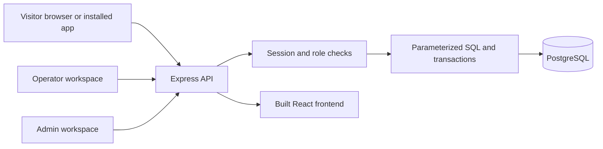
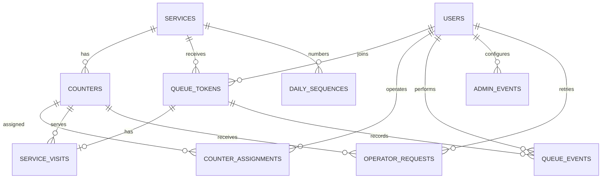

# QueueLess — project report and viva notes

## Purpose and scope

QueueLess lets a campus visitor join a service queue, follow their position, and approach an authorized counter when called. The implementation uses React, an Express JSON API, server-side PostgreSQL sessions, and a normalized PostgreSQL database. It supports visitor, operator and admin accounts. This report describes the implementation; actual deployment, device results and measured performance must be recorded after running the supplied checks.

## Architecture

The UI requests server state and polls active tokens and operator desks every five seconds. Browser state is never permission evidence. An operator's assignment and current database role are checked inside the action transaction. Production serves frontend and API on one HTTPS origin.

## ER diagram

`users` stores identity, hashed credentials and role. `services` stores queue configuration. `counters` belongs to one service; `counter_assignments` is the many-to-many relationship between operators and counters. `daily_sequences` has a composite service/date key. Tokens belong to a visitor and service. A token has at most one service visit. Queue events record joining, cancellation and operator transitions. Admin events record configuration edits. Operator request receipts retain successful results for safe retries. Auth-limit buckets support login and registration throttling. The session-store table is created by connect-pg-simple.

## Normalization

- 1NF: each field holds one value; operators are not stored as comma-separated IDs in counters.
- 2NF: the counter/operator assignment has a composite key; there are no extra attributes that depend on only half that key. Daily sequence values depend on both service and date.
- 3NF: visitor identity is in users; service details are in services; counter names are in counters. Tokens reference those entities instead of duplicating mutable names and emails.

The original services table retains legacy `people_waiting` and `estimated_wait_minutes` columns for compatibility. Application responses calculate queue lengths and estimates from real records instead of reading those legacy example values. `business_date` records the most recent queue admission/opening date. Operational token allocation uses the configured campus timezone's current date; timestamps use PostgreSQL timestamptz, which represents instants in UTC.

## Constraints and state transitions

- Unique email index uses lower(trim(email)). Passwords are bcrypt hashes.
- Unique token number per service/date.
- Partial unique index allows one WAITING/CALLED/SERVING token per visitor/service/day.
- Unique service visit per token.
- Partial unique active-visit index allows one unfinished visit per counter.
- Foreign keys preserve referenced records. Services/counters are closed or disabled, rather than deleted.
- WAITING → CALLED → SERVING → COMPLETED.
- WAITING → CANCELLED; CALLED → NO_SHOW.

A visitor cannot cancel after being called. Completing a visit requires service to have started. Absent status requires an explicit operator confirmation. Historical records stay queryable after cancellation or completion.

## Transactions and concurrency

Join locks the service, checks for an existing active token, increments that service/day sequence and inserts the token and JOINED event atomically. An existing token is returned on retry. A cancellation uses a data-modifying CTE to change the token and insert its event in one statement.

Operator actions lock the acting user, service and counter, verify the assignment, then lock the active/next queue row. Service locking serializes calls within one service and matches the join lock order. A call inserts its visit, changes status, writes an event and stores the successful response in a transaction. A retry with the same request ID returns that response. Active counter visits are protected by an additional unique index. Role and assignment administration uses a shared advisory-lock convention with the local provisioning tool.

Admin edits are parameterized transactions with a fresh role check and an audit record. Self-demotion through the website is prevented; the last admin is protected. The API never accepts a client-supplied actor ID as its source of authority.

## Reporting and estimates

`daily_service_report` is a GROUP BY view by service/date. It reports token counts, terminal and active states, average and median join-to-call wait, and mean start-to-completion service duration. Admin CSV export uses the same report query and escapes cells, including spreadsheet formula prefixes. Reports group by original queue date even when a visit ends later.

Estimates use the last 20 completed durations from seven days. There must be at least three positive samples of at most four hours and at least one enabled counter. The directory uses `ceil(waiting_and_called × mean_duration / enabled_counters)`; an individual waiting token uses its people-ahead count in place of the whole queue. No estimate is displayed when the required data/capacity is missing. Enabled counters represent configured capacity, not guaranteed operator staffing. Estimates are not appointments.

## Security and deployment

Sessions are stored server-side; cookies are HTTP-only and SameSite=Lax, and secure in production. Session IDs regenerate at login. JSON mutation requests require a custom header, an allowed origin where supplied, and reject cross-site browser requests. The API does not enable permissive CORS. No browser credentials, auth responses or queue data are cached by the service worker. Production sets a restrictive CSP and security headers. Authentication is rate-limited using hashed PostgreSQL buckets. Request size is capped at 16 KB, and strings/IDs are validated. Secrets are configured through environment variables.

The Dockerfile packages a single service that serves the compiled UI and API. Production requires HTTPS, APP_ORIGIN, a session secret and database access. Proxy trust must match the actual host. PWA installation is browser-based on iOS and Android; actual device checks remain part of acceptance. Background notifications and app-store publishing are not implemented.

## Verification evidence

Record actual outputs below after running `node release-check.mjs`. Do not replace pending fields with assumed results.

| Item | Evidence |
|---|---|
| Existing operator flow | User reported working before this release |
| Combined frontend build/lint | See preparation checks in CHECKLIST.md |
| Real PostgreSQL release assertions | Pending local execution |
| 100-user / 1,000-token local timing | Pending: record printed milliseconds and machine/OS/PG versions |
| Browser role flow and CSV | Pending local acceptance |
| Actual iPhone installation/login/queue | Pending device test |
| Actual Android installation/login/queue | Pending device test |
| Deployed HTTPS URL | Pending hosting configuration |

The performance script measures local SQL/handler work for directory plus report queries, not HTTP roundtrip time or 100 simultaneous browser users. The 100-user dataset alone does not prove a concurrent-user capacity claim. Add a network/load measurement if required by faculty.

## Demo script

1. Show the service directory and explain open/closed state and estimates.
2. Register/sign in with three distinct visitor accounts; join the same open service.
3. Use two counters assigned to operators. Call next from both and show different tokens.
4. Mark one called visitor absent; start and complete the others.
5. Show each visitor's history and counter instructions.
6. Cancel a new waiting token and rejoin; explain why the new token is at the end.
7. Attempt access with an unassigned operator and explain server rejection.
8. Close the service; new joins/calls stop while an existing visit can finish.
9. Open the admin report and export CSV. Compare counts to SQL.
10. Show an installed phone app using the deployed HTTPS URL, after verifying it on a device.

## Screenshots to capture

Service directory; visitor waiting/called token; operator desk; completed/absent history; admin services and assignments; daily report; installation on each phone; actual passing check output. Screenshots are pending and must show the running application rather than invented data.
